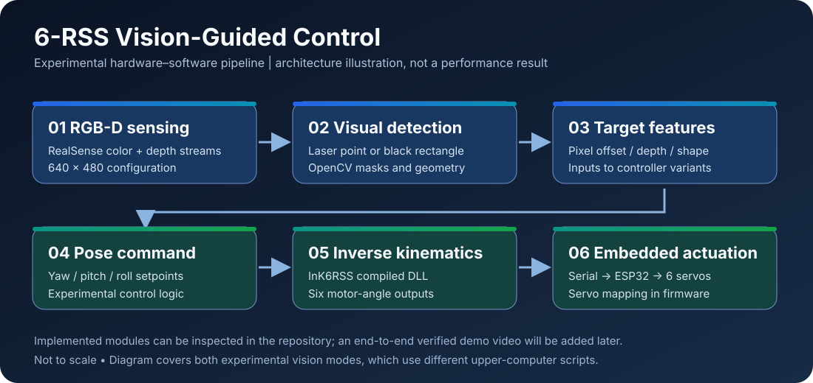

# System Architecture

This document describes modules **visible in the repository**. It is a code-informed map, not a measured end-to-end verification report.

## Overview

The repository contains two experimental visual input paths:

1. **Laser / red-white target**: `vision2.py` uses RGB and depth data, HSV masking and contour-based detection. The `shangweiji11.py` interface retrieves target offsets and feeds experimental proportional pose calculations.
2. **Black rectangle**: `visonblack.py` uses color/depth processing and contour geometry. `shangweijiblack4.py` uses detected dimensions in a discrete square-trajectory generator.

These paths are implemented by **different upper-computer programs**. They should not be described as one proven, interchangeable perception pipeline.

## Modules & Signal Flow

| Module | Source evidence | Outputs / interfaces |
|---|---|---|
| RealSense acquisition | `vision2.py`, `visonblack.py` | 640×480 RGB and depth frames configured at 30 fps |
| Feature extraction | `vision2.py` | Laser-point pixel coordinates, approximate real offsets, measured depth |
| Rectangle extraction | `visonblack.py` | Contour-derived rectangle attributes and depth-based estimates |
| Desktop controller | `shangweiji11.py`, `shangweijiblack4.py` | Pose command / trajectory waypoint |
| Inverse kinematics | `InK6RSSV1.h`, `RSS6RBT_InverseDLL.dll` | Six actuator angles via `InK6RSS(Px,Py,Pz,yaw,pitch,roll,ThetaMn)` |
| Serial link | Python controller scripts | `S,<six comma-separated angles>,E\n` at selected baud rate |
| Embedded interface | `sketch_sep14a.ino` | Six PWM-driven servo channels on ESP32 |

## Integration Assumptions

- **Coordinate mapping is not independently validated.** For example, the laser experiment uses approximations for camera image offsets; these are not a documented pinhole-calibrated camera-to-robot transform.
- **Motion setpoints do not guarantee platform displacement.** At least one controller calculates yaw/pitch from input offsets while passing fixed translation `(0,0,188)` to the inverse solver.
- **Historical code needs runtime auditing.** The laser controller includes both Tkinter and an OpenCV detection interface, with frame/worker interactions that have not been verified for thread safety or synchronized consumption. Multiple update paths also exist.
- **Division-by-zero and singularity exposure:** yaw/pitch calculations in historical programs divide by an x-like coordinate. Guarding and coordinate convention checks should precede real-hardware runs.
- **Actuator safety:** the firmware maps solver angles by alternating sign/offset conventions; a code-level range check is not equivalent to mechanical joint-limit, collision, power or emergency-stop verification.

## Hardware & Software

- RGB-D sensor: Intel RealSense, via `pyrealsense2`.
- Vision/UI: Python, OpenCV, NumPy, Tkinter and Pillow; PySerial.
- Kinematics: compiled DLL accessed with Python `ctypes`; associated header and constants appear in `InK6RSSV1.h`.
- Embedded control: ESP32 firmware, ESP32Servo library and six configured servo pins (`18, 5, 17, 16, 4, 15`).

Hardware model numbers, mechanical design ownership, calibration parameters, performance measurements and solver origin are **not specified by the audited source** and should be added only from original evidence.

## Recommended Future Evidence

A public hardware video can show (a) the physical platform and wiring, (b) sensor input with detection overlays, (c) the desktop interface with serial connection, (d) commanded movements, and (e) a continuous uncut or clearly explained demonstration segment. Any claimed tracking precision or repeatability should be backed by measurements rather than inferred from video alone.
